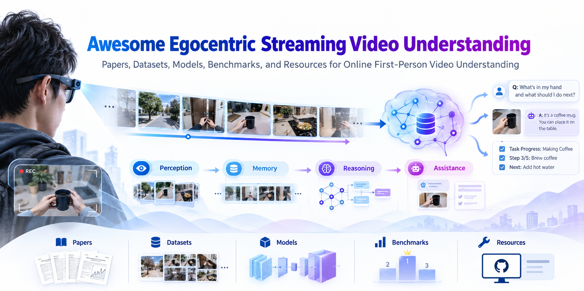

# Awesome Egocentric Streaming Video Understanding

> A curated and **protocol-aware** collection of research on continuous first-person video understanding: online perception, episodic and personalized memory, audio-visual grounding, proactive interaction, and embodied reasoning.

<p align="center">
  
</p>

<p align="center">
  A curated collection of papers, datasets, models, benchmarks, and resources for online first-person video understanding.
</p>

**Status:** Community-curated starter, not an exhaustive survey. Seed entries were cross-checked against authors' papers or project pages on **2026-10-27**, but this is **not** an independent code reproduction or latency audit.

[Research taxonomy](docs/TAXONOMY.md) · [Evaluation protocol](docs/PROTOCOL.md) · [Open questions](docs/RESEARCH_GAPS.md) · [中文指南](docs/README.zh-CN.md) · [Contribute](CONTRIBUTING.md)

## Why this list?

The key question is not just whether a video is long, but whether an agent can **observe causally, maintain useful state, answer or act at the right moment, and adapt to a specific wearer**.

### Scope and evidence tiers

- **Core**: first-person visual input + sequential/online processing claim + an understanding, reasoning, memory, or interactive task.
- **Related**: relevant egocentric long-video or non-egocentric streaming research, without verified satisfaction of all three conditions.
- **Important**: sequential frames at inference and real-time compute are **different properties**. A paper may have causal streaming evaluation yet not operate at camera frame rate.
- **Important**: an offline long-video model evaluated on a multi-day recording should **not** automatically be labeled streaming.

Each paper identifies the evaluation protocol **as described by its authors**, not as independently reproduced. Ambiguous claims are labeled as such rather than upgraded to verified facts.

## Research questions

| Capability | Question |
| --- | --- |
| Online perception | What is unfolding now? |
| Episodic memory | What happened, what changed, and what remains valid? |
| Personalized understanding | What information matters to this particular wearer? |
| Cross-modal grounding | Which earlier/later observed entity does an utterance refer to? |
| Proactive assistance | Should the agent remain silent, answer, or intervene now? |
| Embodied anticipation | What will happen next, and which action is appropriate? |

## Curated papers

_Edit `data/papers.json`, then run `python scripts/build_readme.py` to update this section._

<!-- PAPERS:START -->
_Seed entries: **6** · Core: **5** · Related: **1**. Missing links mean **not recorded**, not necessarily unavailable._

### Core papers

#### Online Perception & Understanding

| Paper | Type | Streaming evidence | Research motivation | Resources |
| --- | --- | --- | --- | --- |
| [EgoSAT: A Comprehensive Benchmark of Egocentric Streaming Interaction Understanding](https://arxiv.org/abs/2606.24422) (2026) | Benchmark | Causal streaming (paper-described) | Retrospective, ongoing, and prospective reasoning under a past-observation-only constraint. | [Paper](https://arxiv.org/abs/2606.24422) · [Project](https://leiyj23.github.io/EgoSAT/) |


#### Continuous Memory & Long-Horizon Reasoning

| Paper | Type | Streaming evidence | Research motivation | Resources |
| --- | --- | --- | --- | --- |
| [EGOSTREAM: A Diagnostic Benchmark for Streaming Episodic Memory in Egocentric Vision](https://arxiv.org/abs/2605.31557) (2026) | Benchmark | Causal streaming (paper-described) | Uses answer validity windows and query-agnostic sequential observation to examine memory over time. | [Paper](https://arxiv.org/abs/2605.31557) · [Project](https://saroo25.github.io/Egostream/) |


#### Proactive Assistance & Situated Interaction

| Paper | Type | Streaming evidence | Research motivation | Resources |
| --- | --- | --- | --- | --- |
| [Vinci2: Providing Proactive Assistance in Continuous Egocentric Videos](https://arxiv.org/abs/2607.11523) (2026) | Method + Benchmark | Online/continuous (author-described) | Links evolving wearer context, memory retrieval, and decisions about whether to intervene. | [Paper](https://arxiv.org/abs/2607.11523) · [Project](https://sitonggong.github.io/EgoServe-page/) |
| [Eyes Wide Open: Ego Proactive Video-LLM for Streaming Video](https://arxiv.org/abs/2510.14560) (2025) | Method + Benchmark | Online/continuous (author-described) | Jointly evaluates answer quality and just-in-time responsiveness on egocentric streams. | [Paper](https://arxiv.org/abs/2510.14560) · [Code](https://github.com/SooLab/EyeWO) · [Project](https://zhangyl4.github.io/publications/eyes-wide-open/) |
| [Proactive Assistant Dialogue Generation from Streaming Egocentric Videos](https://arxiv.org/abs/2506.05904) (2025) | Method + Dataset | Online/continuous (author-described) | Streaming video-to-dialogue generation with proactive response timing for procedural guidance. | [Paper](https://arxiv.org/abs/2506.05904) · [Code](https://github.com/pro-assist/ProAssist) · [Project](https://pro-assist.github.io/) |


### Related papers

These papers inform the research agenda but have not yet been confirmed to meet the strict core scope.

#### Continuous Memory & Long-Horizon Reasoning

| Paper | Type | Streaming evidence | Research motivation | Resources |
| --- | --- | --- | --- | --- |
| [EgoMemReason: A Memory-Driven Reasoning Benchmark for Long-Horizon Egocentric Video Understanding](https://arxiv.org/abs/2605.09874) (2026) | Benchmark | Streaming evaluation not verified | Useful for distinguishing long-horizon memory reasoning from causal online-streaming evaluation. | [Paper](https://arxiv.org/abs/2605.09874) |

<!-- PAPERS:END -->

## Systems and architectures

Technical mechanisms are **tags**, not mutually exclusive tasks: structured event memory, entity memory, KV-cache policies, multimodal streaming, retrieval, persistent summaries, efficient inference, and proactive triggering. A future expansion can compare memory growth, prefill cost, latency, and causal access constraints.

## Benchmarks and datasets

Keep three different objects distinct:

1. **Raw dataset**: is it egocentric, continuous, wearable, audio-enabled, multi-day, and actually downloadable?
2. **Benchmark**: what is the evidence/query timestamp, target task, and leakage policy?
3. **Evaluation harness**: are incoming frames fed incrementally, and can the model retrieve future data or whole-video captions?

See [evaluation checklist](docs/PROTOCOL.md) before labeling any benchmark as strictly streaming.

## Foundational and adjacent collections

- [Awesome-VLM-Streaming-Video](https://github.com/ydyhello/Awesome-VLM-Streaming-Video) — streaming VLM models and techniques.
- [Awesome-Streaming-Video-Understanding](https://github.com/sotayang/Awesome-Streaming-Video-Understanding) — online video tasks, models, and benchmarks.
- [Awesome Egocentric Vision](https://github.com/Sid2697/awesome-egocentric-vision) — broader first-person vision.
- [Awesome Egocentric Video Datasets](https://github.com/player0718/awesome-ego-video-datasets) — egocentric data and benchmarks.

## Maintain and contribute

To add a paper, edit `data/papers.json`, then run:

```bash
python scripts/build_readme.py
python scripts/build_readme.py --check
```

Submit a pull request following [CONTRIBUTING.md](CONTRIBUTING.md). Keep at least a paper link and a short **research-motivated** description for each new entry. Missing code and missing modality information are **unknown**, not presumed absent.

## Attribution and licensing

Paper titles and official URLs point to their respective authors; individual papers and datasets retain their original licenses. This starter does not redistribute videos, datasets, figures, or paper PDFs. Choose and add a suitable repository license before public release.
